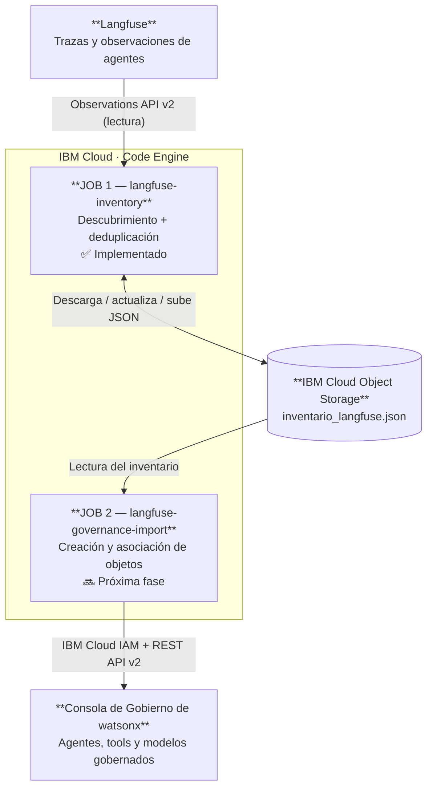
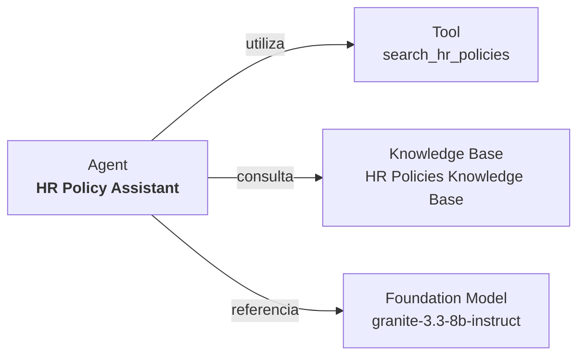
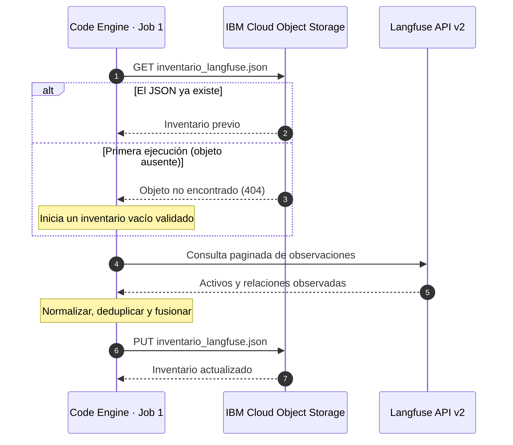
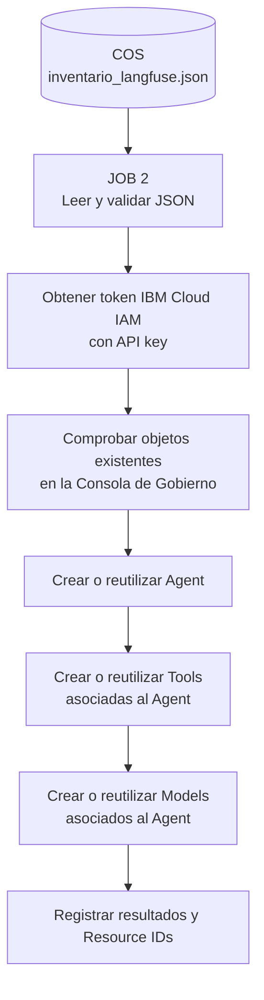

# Langfuse Asset Inventory · IBM Cloud Code Engine

**De la observabilidad de agentes al inventario de gobierno, mediante dos Jobs independientes.**

Este repositorio implementa el **Job 1: inventario incremental de activos observados en Langfuse**. Descubre agentes y componentes relacionados a partir de trazas de observabilidad, consolida un inventario JSON y lo mantiene en **IBM Cloud Object Storage (COS)**.

El inventario se utiliza después como entrada de un **Job 2 de importación a la Consola de Gobierno de watsonx**, desarrollado y desplegado por separado. El segundo Job se muestra aquí para explicar la arquitectura completa, **pero su código no forma parte de este repositorio**.

> [!IMPORTANT]
> **Estado de la demo:** el Job 1 está implementado y validado en IBM Cloud Code Engine, incluido el comportamiento incremental tras ejecuciones repetidas. El importador de agentes, herramientas y modelos se ha validado de forma local contra una consola de prueba; **su despliegue como Job 2 de Code Engine es el siguiente paso**. No hay ninguna ejecución periódica programada.

---

## 1. Visión general



Los dos Jobs tienen responsabilidades diferentes y **no se ejecutan dentro del mismo contenedor**:

| Componente | Responsabilidad | Estado |
|---|---|---|
| **Job 1 · `langfuse-inventory`** | Descubrir activos en Langfuse y actualizar el JSON en COS sin duplicados. | ✅ Operativo en Code Engine |
| **IBM Cloud Object Storage** | Conservar el inventario compartido entre ejecuciones y Jobs. | ✅ Operativo |
| **Job 2 · `langfuse-governance-import`** | Leer el JSON de COS y crear/reutilizar objetos y asociaciones en la Consola de Gobierno. | 🔜 Despliegue pendiente en Code Engine; importación validada localmente |

**Punto clave:** no se requiere desplegar un agente real ni llamar a modelos para inventariar los activos; pueden descubrirse a partir de trazas existentes o sintéticas. La información del inventario **no demuestra que los componentes descubiertos estén desplegados ni operativos**.

---

## 2. ¿Qué descubre el Job 1?

Se consultan las observaciones de Langfuse para identificar cinco categorías de activos:

| Categoría | Descripción | Ejemplo |
|---|---|---|
| **Agents** | Agentes observados en ejecuciones. | `HR Policy Assistant` |
| **Tools** | Herramientas utilizadas por un agente. | `search_hr_policies` |
| **Knowledge Bases** | Fuentes o bases de conocimiento identificadas en trazas RAG. | `HR Policies Knowledge Base` |
| **MCP Servers** | Servidores MCP explícitamente identificados en los datos. | Servidor MCP externo |
| **Foundation Models** | Modelos referenciados en observaciones de generación. | `granite-3.3-8b-instruct` |

Además de los activos, el inventario conserva **identidades, metadatos selectivos, primera detección y relaciones** cuando pueden inferirse de forma fiable. Por ejemplo:



**Reglas de descubrimiento:**

- Se deduplica utilizando identificadores explícitos cuando están disponibles; en su defecto, se recurre a la identidad contextual recogida en el inventario.
- Una ejecución posterior **añade los activos nuevos** y conserva los existentes, aunque no vuelvan a observarse en la última ventana consultada.
- Las relaciones se mantienen asociadas a los recursos inventariados.
- **No se inventan recursos:** la ausencia de un modelo, una knowledge base o un servidor MCP en las trazas no implica que se deba registrar uno.
- No se guardan trazas completas, prompts, documentos ni datos personales de las interacciones: únicamente los atributos de identificación y los metadatos necesarios para inventariar.

### Ciclo de una ejecución



> [!CAUTION]
> Si COS falla por permisos, conectividad o un problema distinto a la ausencia del objeto, el Job **termina con error**. No hay persistencia alternativa local. El directorio temporal del contenedor solo sirve para procesar los datos durante ese JobRun.

---

## 3. ¿Qué hará el Job 2 con ese inventario?

El segundo Job ejecutará el importador de gobierno probado localmente, pero con una **lectura previa del JSON desde COS**, sin descargarlo manualmente a WSL.



**Modelo de relaciones esperado:**

```text
Business Entity (existente en la consola)
└── Agent · HR Policy Assistant
    ├── AI Tool · search_hr_policies
    └── Model   · granite-3.3-8b-instruct
```

El Job 2 trabajará con objetos normales de la **Consola de Gobierno de watsonx** mediante su REST API. **No equivale a registrar activos Shadow en AI Discovery** ni a desplegar el modelo, crear una herramienta ejecutable o reconstruir el agente en un runtime.

La importación se realizará de forma incremental: reutilizando objetos identificados previamente y evitando crear duplicados. Si encuentra asociaciones inconsistentes, el importador deberá reportarlas en lugar de reasignar recursos silenciosamente.

**Límites de la primera fase del importador:** agentes, tools y modelos. El JSON también puede contener knowledge bases y MCP servers, pero su importación se tratará como una ampliación posterior.

---

## 4. Contenido de este repositorio

```text
.
├── inventariar_langfuse.py     # Descubrimiento vía Langfuse Observations API v2
├── run_job.py                  # Orquestador del Job 1: COS → Langfuse → COS
├── Dockerfile                 # Imagen construida desde GitHub por Code Engine
├── requirements.txt           # Dependencias, incluido el SDK de IBM COS
├── .env.example               # Plantilla sin credenciales reales
├── .gitignore
├── .dockerignore
├── tests/
│   └── test_inventory.py      # Pruebas unitarias locales
└── README.md                  # Esta documentación
```

> El futuro **Job 2 se mantendrá en otro repositorio**, con su propio `Dockerfile`, variables, secretos y Job de Code Engine. Ambos se conectan únicamente a través del objeto JSON de COS.

---

## 5. Requisitos previos

1. Un proyecto en **Langfuse** con observaciones y credenciales de API con acceso de lectura.
2. Una instancia de **IBM Cloud Object Storage**, un bucket ya creado y una API key con permisos adecuados sobre ese bucket.
3. Un proyecto de **IBM Cloud Code Engine** con acceso de salida a Langfuse y al endpoint de COS.
4. Un repositorio de **GitHub** con los archivos de este proyecto en la raíz, especialmente `Dockerfile`.
5. Para probar en WSL: **Python 3**, `venv` y las dependencias especificadas en `requirements.txt`.

**Endpoint COS:** utiliza el endpoint regional HTTPS que realmente sea accesible desde Code Engine. En esta demo se usa la variante **pública**, no el endpoint `direct`. No presupongas conectividad al endpoint privado/direct entre redes o cuentas distintas.

---

## 6. Variables de entorno del Job 1

| Variable | Obligatoria | Descripción |
|---|---|---|
| `LANGFUSE_BASE_URL` | Sí | URL base de Langfuse; ej. `https://cloud.langfuse.com` |
| `LANGFUSE_PROJECT_ID` | Sí | ID del proyecto del que se leen observaciones |
| `LANGFUSE_PUBLIC_KEY` | **Sí · Secret** | Public key de la API de Langfuse |
| `LANGFUSE_SECRET_KEY` | **Sí · Secret** | Secret key de la API de Langfuse |
| `COS_ENDPOINT` | Sí | Endpoint regional HTTPS accesible desde Code Engine |
| `COS_API_KEY` | **Sí · Secret** | API key con lectura/escritura sobre el bucket |
| `COS_SERVICE_INSTANCE_ID` | Sí | CRN de la instancia de COS (`resource_instance_id`) |
| `COS_BUCKET` | Sí | Nombre del bucket existente |
| `COS_OBJECT_KEY` | No | `inventario_langfuse.json` |
| `INVENTORY_DAYS` | No | `30`; días hacia atrás respecto a la ejecución |
| `INVENTORY_FROM` / `INVENTORY_TO` | No | Rango ISO UTC alternativo; `TO` exclusivo |
| `INVENTORY_PAGE_SIZE` | No | `500`; máximo `1000` |
| `INVENTORY_INSPECT_IO` | No | `false`; inspección selectiva de identificadores en I/O estructurado |
| `INVENTORY_DRY_RUN` | No | `false`; si es `true`, no sobrescribe COS |
| `INVENTORY_PRINT_JSON` | No | `false`; evita imprimir el inventario completo en logs |

No existe `INVENTORY_STORAGE` ni opción de persistencia `local`. El JSON se procesa temporalmente durante el JobRun, pero **su fuente de verdad es COS**.

El Job 2 utilizará **otras variables y credenciales**, incluidas las de IAM para la Consola de Gobierno. No necesita acceder a los secretos de Langfuse: consume el inventario ya preparado.

---

## 7. Pruebas locales (WSL)

Crea un entorno virtual para evitar incompatibilidades con la instalación de Python del sistema (incluido PEP 668):

```bash
python3 -m venv .venv
source .venv/bin/activate
python3 -m pip install -r requirements.txt
python3 -m unittest discover -s tests -v
```

Carga las variables de entorno sin subirlas al repositorio. Si tienes un `.env` local con líneas `KEY=value`, puedes cargarlo así:

```bash
set -a
source .env
set +a
```

Comprueba que `COS_BUCKET`, `COS_ENDPOINT` y el resto de las variables estén configuradas. Para una ejecución de inspección que no modifique el objeto remoto:

```bash
INVENTORY_DRY_RUN=true python3 run_job.py
```

Para ejecutar el proceso completo:

```bash
python3 run_job.py
```

Una **segunda ejecución** recuperará el inventario existente, detectará los recursos ya conocidos y añadirá únicamente los nuevos. Que el recuento total no aumente es el comportamiento esperado si no existen nuevos activos en Langfuse.

> [!WARNING]
> El `.env` puede contener secretos. Debe permanecer fuera de Git mediante `.gitignore`. Evita compartirlo, incluirlo en imágenes Docker o pegar sus valores en incidencias y logs.

---

## 8. Desplegar el Job 1 desde GitHub en Code Engine

### Paso 1 · Publicar el código

Sube **los archivos descomprimidos**, no el ZIP, a la raíz de un repositorio GitHub. Verifica que `Dockerfile` y `run_job.py` estén en la raíz. Si el repositorio es privado, configura el acceso de Code Engine al repositorio.

### Paso 2 · Seleccionar el proyecto de Code Engine

```bash
ibmcloud login --sso
ibmcloud target -r eu-de
ibmcloud ce project select --name TU_PROYECTO_CODE_ENGINE
```

Modifica `eu-de` si tu proyecto de Code Engine reside en otra región.

### Paso 3 · Crear el Secret

En **IBM Cloud → Code Engine → Secrets**, crea un secreto genérico llamado:

```text
langfuse-inventory-credentials
```

Incluye estas claves:

```text
LANGFUSE_PUBLIC_KEY
LANGFUSE_SECRET_KEY
COS_API_KEY
```

Recomendamos hacerlo desde la consola para no dejar credenciales en el historial de la terminal. Si lo prefieres, `COS_SERVICE_INSTANCE_ID` también se puede guardar como secreto.

### Paso 4 · Crear el Job desde GitHub

```bash
ibmcloud ce job create \
  --name langfuse-inventory \
  --build-source https://github.com/TU_USUARIO/langfuse-asset-inventory \
  --env-from-secret langfuse-inventory-credentials \
  --env LANGFUSE_BASE_URL=https://cloud.langfuse.com \
  --env LANGFUSE_PROJECT_ID=TU_PROJECT_ID \
  --env COS_ENDPOINT=https://s3.eu-de.cloud-object-storage.appdomain.cloud \
  --env COS_SERVICE_INSTANCE_ID=TU_COS_RESOURCE_INSTANCE_CRN \
  --env COS_BUCKET=TU_BUCKET \
  --env COS_OBJECT_KEY=inventario_langfuse.json \
  --env INVENTORY_DAYS=30 \
  --wait
```

Ajusta la URL de GitHub, la región de COS, el CRN, el bucket y el proyecto. **No copies una API key directamente en `--env`: utiliza el Secret.**

### Paso 5 · Lanzar la ejecución manual

```bash
ibmcloud ce jobrun submit \
  --job langfuse-inventory \
  --name langfuse-inventory-test

ibmcloud ce jobrun logs --jobrun langfuse-inventory-test
```

El JobRun descarga el inventario previo si existe y lo actualiza en COS. En la primera ejecución es normal que el objeto aún no exista. **El bucket, sin embargo, debe estar creado de antemano.**

### Paso 6 · Validar el resultado

Comprueba en IBM Cloud Object Storage que existe:

```text
TU_BUCKET / inventario_langfuse.json
```

Repite manualmente el JobRun con **otro nombre único** y confirma que el número de agentes, tools y modelos no crece cuando no hay nuevos recursos. Los recursos nuevos que se observen en Langfuse sí deben añadirse.

**Importante:** no se configura ningún cron ni trigger automático para esta demo. La automatización es posible en Code Engine, pero no forma parte del despliegue actual.

---

## 9. Continuidad: despliegue del Job 2

Cuando esté preparado el segundo repositorio, se desplegará como un **Job distinto** dentro del proyecto de Code Engine. Su flujo será:

1. Descargar `inventario_langfuse.json` del mismo bucket COS.
2. Validar que el inventario corresponde al proyecto esperado.
3. Obtener un token IBM Cloud IAM mediante una API key autorizada para la Consola de Gobierno.
4. Buscar y reutilizar los agentes ya creados, o crearlos si no existen.
5. Crear las **AI Tools** y los **Models** bajo el agente correspondiente, conservando las relaciones.
6. Registrar los Resource IDs y los resultados de la importación.

| Característica | Job 1 · Inventory | Job 2 · Governance Import |
|---|---|---|
| Lee Langfuse | Sí | No |
| Lee COS | Sí | Sí |
| Escribe COS | Sí | No: solo consume el JSON |
| Escribe en la Consola de Gobierno | No | Sí |
| Credenciales principales | Langfuse + COS | COS + IBM Cloud IAM |
| Ejecución | Manual | Manual |
| Resultado | Inventario persistente | Objetos y asociaciones de gobierno |

La ejecución de la demo seguirá este orden:

```text
1. Ejecutar Job 1  →  COS actualizado
2. Validar el JSON →  Agentes y relaciones correctos
3. Ejecutar Job 2  →  Agentes, tools y modelos en la Consola de Gobierno
4. Verificar       →  Asociaciones y ausencia de duplicados
```

No hay dependencia de ejecución automática ni de un pipeline continuo; ambos Jobs son independientes y pueden inspeccionarse y repetirse por separado.

---

## 10. Seguridad, consistencia y límites

- **COS es obligatorio:** no se sustituye por almacenamiento efímero o un archivo local persistente.
- **Errores de acceso:** cualquier error distinto del objeto no encontrado provoca fallo, sin reconstruir el inventario vacío por accidente.
- **Integridad:** se valida el JSON antes de actualizarlo y se comprueba que pertenece al proyecto esperado.
- **Lectura paginada:** Langfuse se consulta mediante la Observations API v2.
- **Sin secretos en el código:** las claves se suministran mediante Secrets de Code Engine.
- **Datos minimizados:** no se almacenan trazas completas, entradas/salidas de los modelos ni contenido documental.
- **Sin duplicados intencionados:** el inventario utiliza identidad estable o contextual, y el futuro importador verificará los objetos existentes.
- **Control de concurrencia:** ejecuta **un único JobRun escritor** del inventario cada vez. Dos ejecuciones simultáneas podrían sobrescribirse mutuamente; COS no ofrece una transacción de lectura-modificación-escritura en este flujo.
- **Copia de seguridad:** para una demo repetible, considera habilitar versionado del bucket o guardar una copia del JSON antes de realizar cambios importantes.
- **Fallos parciales:** al migrar el importador al Job 2, la creación de agentes y componentes no será una operación transaccional conjunta. El script deberá poder retomarse sin duplicar objetos tras un fallo intermedio.
- **Trazas simuladas:** un recurso encontrado en las trazas no debe presentarse como infraestructura realmente desplegada ni como activo ya gobernado.

---

## 11. Documentación de referencia

- [IBM Cloud Object Storage — Python SDK](https://cloud.ibm.com/docs/cloud-object-storage?topic=cloud-object-storage-python)
- [IBM Code Engine — Ejecutar Jobs desde código fuente](https://cloud.ibm.com/docs/codeengine?topic=codeengine-run-job-source-code)
- [IBM Code Engine — Secrets](https://cloud.ibm.com/docs/codeengine?topic=codeengine-secret)
- [IBM Code Engine — Programación mediante cron (opcional, no utilizada)](https://cloud.ibm.com/docs/codeengine?topic=codeengine-subscribe-cron)
- [Langfuse — Public API](https://langfuse.com/docs/api-and-data-platform/features/public-api)

---

**Objetivo de esta arquitectura:** demostrar cómo se puede partir de la observabilidad real o simulada de agentes, descubrir automáticamente sus componentes y trasladar ese inventario a una plataforma de gobierno, manteniendo **descubrimiento, persistencia e importación como responsabilidades separadas y trazables**.
